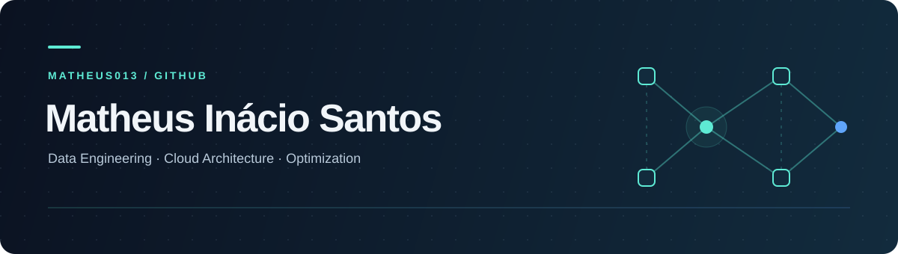

  

  <strong>Senior Data Engineer · Cloud Architecture · DataOps</strong>

  <a href="https://www.linkedin.com/in/mib-santos/">LinkedIn</a>
  &nbsp;·&nbsp;
  <a href="mailto:matheusinacio.bs@gmail.com">Email</a>
  &nbsp;·&nbsp;
  <a href="https://www.instagram.com/matheusinacio.bs/">Instagram</a>

---

### Data, from architecture to operations

I'm Matheus, a Senior Data Engineer working on **scalable data architectures, distributed pipelines, and automation** across cloud and on-premises environments. I build platforms that balance performance, governance, and cost efficiency.

My work brings together data engineering and DataOps, from infrastructure as code to orchestration and data transformation. I'm also pursuing a **master's degree in Optimization**, exploring mathematical modeling to solve complex problems, and sharing knowledge through mentoring and technical content.

### Tools & expertise

| Area | Technologies & focus |
| :--- | :--- |
| **Data engineering** | Python · PySpark · SQL · Spark |
| **Cloud & infrastructure** | AWS · Athena · Terraform |
| **Orchestration & transformation** | Apache Airflow · dbt |
| **Storage & architecture** | PostgreSQL · Data Lakes · Lakehouses |
| **Operations & governance** | DataOps · Data Governance · FinOps |

### Projects to explore

Beyond data engineering, my repositories include experiments in software development, automation, and hardware integration.

| Project | What you'll find |
| :--- | :--- |
| **[DevForge AI](https://github.com/matheus013/devforge)** | A software management platform prototype with planning, approvals, and simulated agent runs. Built with Django, Next.js, and Docker Compose. |
| **[LED Sync](https://github.com/matheus013/led-sync)** | Unified PC RGB lighting control with OpenRGB integration, audio-reactive effects, and GPU control over I²C. |

[Explore all repositories →](https://github.com/matheus013?tab=repositories)

### On my radar

- **Performance:** optimizing Spark jobs with Adaptive Query Execution.
- **Reliability:** CI/CD for data pipelines, data quality, and observability.
- **Metadata & validation:** integrations with OpenMetadata and Great Expectations.

---

**Let's connect.** I'm happy to exchange ideas about data architecture, optimization, and open-source projects. Reach out on [LinkedIn](https://www.linkedin.com/in/mib-santos/) or by [email](mailto:matheusinacio.bs@gmail.com).
